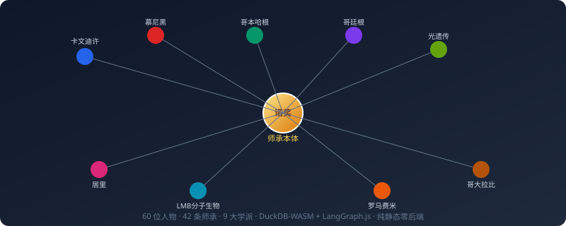
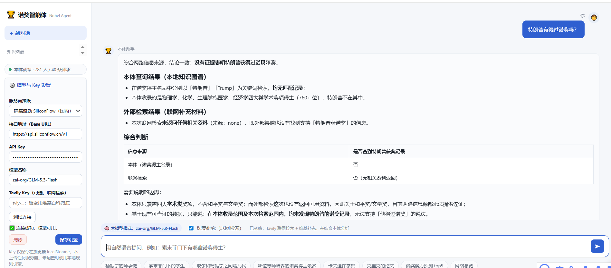

# 🏆 Nobel KG —— 诺奖师承知识本体 Agent

> LangGraph.js + DuckDB-WASM · 纯静态零后端 · 可直接部署到 GitHub Pages

本项目是一套**完全在浏览器内运行**的诺奖得主师承关系知识本体与 AI Agent：

- **本体数据**通过 DuckDB-WASM 在浏览器本地加载 Parquet 并执行 SQL（含递归 CTE）；
- **智能体**由 LangGraph.js 编排状态图（规划 → 调工具 → 综合成文）；
- **没有后端服务器**，所有查询在访问者浏览器内完成，API Key 仅保存在访问者本地 `localStorage`。



---

## 📊 本体规模（v3.0 全量重建）

本版本采用**双层本体设计**：

- **名录层（v3.0 新增）**：覆盖学术四奖（物理/化学/生理学或医学/经济学，1901–2026）共 **765 位** 得主；
- **师承子图**：以高价值、可核验师承边为核心的研究密集层；
- 两层通过 `person_id` 关联，查询时按需 join，不会把孤立节点塞进网络指标计算。

| 实体 | 数量 | 说明 |
|---|---|---|
| 人物总数 | **781** | 765 位诺奖得主 + 16 位关键导师（非诺奖但必纳入师承链） |
| **诺奖得主名录** | **765** | 学术四奖全量：物理 235 / 化学 203 / 生理医学 235 / 经济学 99；含 2026 新晋 |
| 师承子图诺奖得主 | **44** | 高价值、已核查师承关系的核心网络 |
| 师承边 | **40** | 博士导师/博士后导师/研究导师/家族传承，均带核验状态 |
| 家族边 | **7** | 居里夫妇/母女、玻尔父子、布拉格父子、汤姆孙父子、约里奥-居里等 |
| 学派 | **9** | 卡文迪许/慕尼黑/哥本哈根/哥廷根/罗马费米/LMB/居里/光遗传/哥大拉比 |
| 研究范式 | **11** | 量子力学、QED、X射线晶体学、光遗传学、不对称催化、核物理、中微子天文等 |
| 代表论文 | **68** | 里程碑论文带 DOI/期刊；`paper_lineage` 记录 **35 条**论文间思想传承 |
| 论文作者 | **67** | 区分第一作者/共同一作/通讯作者 |
| 研究方向 | **26** | 三级学科树 |
| 代表性工作 | **57** | 细到具体贡献（光电效应/希格斯机制/DNA证据等） |
| 机构 | **48** | 卡文迪许实验室/索末菲研究所/镭研究所/LMB 等 |
| 合作关系 | **12** | 关键论文合作（光遗传/DNA/哥本哈根诠释/宇称不守恒等） |
| 人物量化特征 | **781** | 中心性/PageRank/学术深度/诺奖祖先·学生数/转化率/综合潜力分（仅在世未获奖者参与潜力排序） |
| 诺贝尔奖记录 | **412** | 1901–2026 学术四奖全量获奖（按 year+category 聚合） |
| 数据订正记录 | **18** | 调查中发现的错误与补全留痕 |

> 文学奖与和平奖**未纳入**：前者无学术师承结构，后者约 1/4 得主为组织，会破坏本体一致性；详见决策文档。

---

## 🗂️ 项目结构

```
nobel-kg/
├── index.html                   # 主页面（欢迎页 / 图谱入口 / 问答 / 设置）
├── viz/                         # 师承关系可视化页（均从 data/ 读 Parquet，与主页同源）
│   ├── 师承关系图谱.html
│   ├── 师承关系拓扑图_含代表作.html
│   └── 论文层与合著网络.html
├── css/style.css                # 全站样式
├── js/                          # 核心 JS 模块（ESM）
│   ├── config.js                # 本地配置（localStorage），服务商预设
│   ├── db.js                    # DuckDB-WASM 数据层（加载 Parquet + SQL）
│   ├── tools.js                 # 12+ 本体查询白名单工具（不给模型裸 SQL）
│   ├── router.js                # 本地规则引擎（未配大模型时的关键词路由）
│   ├── wiki.js                  # 维基百科 / Wikidata 零 Key 联网检索
│   ├── agent.js                 # LangGraph.js 状态图（plan → act → compose）
│   ├── render.js                # Markdown / 表格 / SVG 图表 / 内嵌 iframe 渲染
│   └── main.js                  # 界面控制器（串联数据 → 工具 → Agent → 渲染）
├── data/                        # ⭐ 唯一数据源：33 张 Parquet + manifest.json
│   ├── persons.parquet
│   ├── mentorship.parquet
│   ├── papers.parquet
│   ├── schools.parquet
│   ├── features.parquet
│   └── ... (共 33 张 parquet，合计约 430KB)
├── lib/
│   ├── duckdb.bundle.js         # DuckDB-WASM 打包（mvp 单线程）
│   ├── duckdb/                  # WASM 内核 + Worker（本地化，不依赖 CDN，约 40MB）
│   ├── langgraph.bundle.js      # LangGraph.js + @langchain/openai 打包
│   └── vendors/                 # echarts / d3 / tailwind 本地拷贝（供 viz 使用）
├── viz/                         # 独立可视化页（数据均内嵌在 HTML，无 SQL 依赖）
│   ├── 和平奖领域与组织图谱.html
│   ├── 论文层与合著网络.html
│   ├── 诺奖年谱.html
│   ├── 诺奖时光机.html
│   ├── 师承关系拓扑图_含代表作.html
│   ├── 师承六度挑战.html
│   ├── 文学奖作品与传承图谱.html
│   └── 学术星座图.html
├── assets/                      # 站点图标/图片
├── mock_server.py               # 本地 Mock OpenAI 端点（零真 Key 测试 Agent 链路）
├── .nojekyll                    # 让 GitHub Pages 不跑 Jekyll（避免下划线目录被忽略）
├── BUILD.md                     # 📘 构建文档：如何新增数据 / 重建 / 迭代
├── TECH.md                      # 📗 技术文档：本体论模型 / 架构 / 关键决策
└── README.md                    # 本文档
```

---

## 🚀 本地预览

```bash
# 进入项目目录
cd nobel-kg

# 启动本地静态服务器（⚠️ 必须通过 HTTP 访问，直接双击 html 会被浏览器安全策略阻止）
python3 -m http.server 8080

# 然后浏览器打开
#   http://localhost:8080/
```

页面启动后**不阻塞任何交互**——UI 立即可浏览（侧栏、图谱入口、设置、欢迎语均可点击），DuckDB-WASM（约 40MB）在后台异步加载。首次提问时才等待 DB 就绪；加载完成后 `Cache Storage` 会记住 WASM 与 Parquet 字节，**下次打开页面几乎秒回**。

### 零真 Key 测试 Agent 全链路（可选）

如果想测试 LangGraph 的「规划 → 调工具 → 综合」完整流程，但又不想消耗自己的 API Key，可以用仓库自带的 Mock 服务：

```bash
python3 mock_server.py 8090
```

浏览器打开 `http://localhost:8090/`，在右上角 ⚙️ 设置里填入：

- Base URL：`http://localhost:8090/v1`
- Model：`mock`
- API Key：任意值（如 `test`）

保存后即可体验 LLM 模式的完整工作流（工具调用 + 流式输出）。Mock 返回固定文本，**仅用于验证链路正确性**，真要用自然语言任意提问需要接入真实模型。

---

## 🔑 配置大模型

本项目是纯静态页面，**没有内置任何 API Key**。访问者需要自备一个兼容 OpenAI 的大模型接口，Key 仅写入本地 `localStorage`，**不会上传到任何服务器**，也不会随页面分发。

### 支持的服务商预设

| 服务商 | 默认 Base URL | 推荐模型 | 浏览器直连 |
|---|---|---|---|
| **OpenRouter（推荐）** | `https://openrouter.ai/api/v1` | `openai/gpt-4o-mini`、`deepseek/deepseek-chat` | ✅ 官方支持 |
| **硅基流动（国内）** | `https://api.siliconflow.cn/v1` | `Qwen/Qwen2.5-7B-Instruct`、`deepseek-ai/DeepSeek-V3` | ⚠️ 多数可用 |
| **DeepSeek 官方** | `https://api.deepseek.com/v1` | `deepseek-chat`、`deepseek-reasoner` | ⚠️ 可能被跨域拦截 |
| **自建中转**（one-api / new-api 等） | 你的中转地址 | 任选 | ⚠️ 需自配 CORS |

> ⚠️ **官方 OpenAI 接口无法浏览器直连**：`api.openai.com` 的跨域预检会被 Cloudflare 拦截，这是官方有意为之（避免密钥暴露在客户端）。需使用 OpenRouter 或自建中转。

### 如何获取 Key

- OpenRouter：<https://openrouter.ai/keys>，注册即送少量免费额度，有免费模型可用
- 硅基流动：<https://cloud.siliconflow.cn/account/ak>
- DeepSeek：<https://platform.deepseek.com/api_keys>

### 深度研究（联网检索）

**属于「需配置才会启用」的能力。** 只有在你填写了检索 Key（Tavily）后，代码层才会启用深度研究这条路径；未配置时该能力不会运行，界面上的开关也保持禁用。

启用后的检索采用「双源」策略：

- **优先调用 Tavily**（专为 Agent 设计的搜索 API，覆盖面更广）；
- **Tavily 调用失败时**，自动回退到维基百科 / Wikidata（MediaWiki API 与 Wikidata SPARQL 端点原生支持跨域），保证仍然能拿到参考资料。

检索结果会与本体查询结果一起交给模型综合，并在回答中标注哪些内容来自外部检索。

Tavily 申请：<https://tavily.com>（免费额度足够日常使用）。

---

## 🤖 Agent 能做什么

### 未配置大模型（本地规则引擎）

通过关键词 + 实体识别把自然语言问题路由到白名单工具，**完全离线可用**：

- 师承链追溯：`杨振宁的师承链`、`索末菲门下的学生`
- 两点师承路径：`玻尔和杨振宁之间隔几代`
- 人物画像：`玻尔`、`卡甘`、`钱永佑`
- 导师产出力排名：`哪位导师培养的诺奖得主最多`
- 学派详情：`卡文迪许学派`、`哥本哈根学派`、`光遗传学派`
- 论文与代表作：`克里克的论文`、`光遗传 论文`、`论文时滞`
- 研究方向：`光遗传学`、`量子力学`
- 网络统计：`网络总览`
- 诺奖潜力预测：`诺奖潜力预测 top5`
- 人才流动、合作网络、研究范式、数据订正记录等

### 配置大模型（LangGraph.js 状态图）

LLM 自主决定调用哪些本体查询工具，可**多步推理**、**自然语言任意提问**：

- 综合分析：`比较卡文迪许学派和慕尼黑学派对20世纪物理的影响`
- 反事实推理：`如果索末菲当年也获了诺奖，会改变学派历史走向吗`
- 前沿预测：`结合师承特征和论文产出，预测未来5年最可能获奖的人`
- 深度研究：`综述光遗传学的学术传承脉络，并补充近年最新进展`（会联网检索）

#### 实际问答示例

> 提问：「特朗普有得过诺奖吗？」——Agent 同时查询本地本体名录与联网检索（Tavily），两路信息源交叉验证后给出结论与边界说明：



### 深度研究（Deep Research）

勾选输入框下的「深度研究（联网检索）」开关，Agent 会：

1. 先用本地本体工具查得核心事实；
2. 再联网检索（Tavily 或维基兜底）补充外部资料；
3. 综合两部分结果组织成最终回答。

未配置大模型时该开关始终禁用。

---

## 🧱 本体论建模原则

**师承关系作为一等概念**：`mentorship` 不是简单的属性，而是独立实体，承载 `relation_type`（博士/博士后/研究导师/家族传承）、`is_phd`、`start_year`、`institution_id`、`verification_status`、`source` 等属性——这样 Agent 才能区分"谁是谁的导师""是哪一阶段的导师""这条关系是否已核验"。

**TBox + ABox 分离**：`03_本体论规范/nobel_kg_ontology.ttl`（类/属性定义）和 `nobel_kg_knowledge.ttl`（实例数据，约 4200 条三元组）可导入任意 RDF/图数据库（Protégé、Jena、GraphDB 等），rdflib 校验通过。

**业务查询固化为白名单**：不向大模型暴露裸 SQL，每个工具是带 JSON Schema 的白名单函数，既防注入又提高准确率。

---

## 🌐 部署到 GitHub Pages

### 方法一：直接上传（最简单）

1. 在 GitHub 上创建仓库（建议命名 `nobel-kg`）；
2. 把整个项目目录的内容推送到仓库的 `main` 分支；
3. 进入仓库 `Settings → Pages`，Source 选 `Deploy from a branch`，Branch 选 `main`，Folder 选 `/ (root)`；
4. 等 1–2 分钟，访问地址为 `https://<你的用户名>.github.io/nobel-kg/`。

> `.nojekyll` 文件已在根目录，这会让 GitHub Pages 直接返回所有静态文件（不会被 Jekyll 处理，避免以下划线开头的目录被忽略）。

### 方法二：GitHub Actions 自动部署

如果你希望 CI 自动部署，可以参考 GitHub 官方的 Pages Action 配置。本项目不需要构建步骤，直接把根目录发布即可。

### 子路径注意事项

所有资源路径都使用相对路径（基于 `document.baseURI` 解析），所以：

- 部署到 `https://<user>.github.io/<repo>/`（子路径）正常工作；
- 部署到 `https://<user>.github.io/`（根域名仓库 `user.github.io`）同样正常工作；
- 本地 `python3 -m http.server` 也正常。

---

## 🧪 技术栈

- **DuckDB-WASM 1.33**：浏览器内 OLAP 数据库，直读 Parquet，支持递归 CTE；
- **LangGraph.js 1.4**：有状态的 Agent 工作流编排（`StateGraph` + `Annotation`）；
- **@langchain/openai**：OpenAI 兼容接口客户端（`ChatOpenAI`，支持自定义 `baseURL`）；
- **本地实现**：Markdown 渲染、SVG 图表（柱状图、饼图、环形图）、iframe 图谱嵌入，**无前端框架依赖**；
- **可视化页面**：ECharts 5.6 / D3 v7（已本地拷贝，无需联网）。

---

## ❓常见问题

**Q：为什么第一次打开会有加载？**
A：DuckDB-WASM 的 `.wasm` 文件约 40MB，首次访问需要下载。加载过程**不阻塞页面**——侧栏、图谱入口、设置、欢迎语在页面加载后即可使用，只有首次提问才会等待 WASM 就绪；加载完成后会写入浏览器的 `Cache Storage`，下次打开几乎秒回。若网络缓慢，可先浏览图谱或看其他页面，回到主页时 WASM 通常已下载完毕。

**Q：为什么我填了 Key 还是连不上？**
A：大概率是跨域（CORS）。浏览器控制台会显示具体错误。官方 OpenAI 和部分国内服务会拦截浏览器直连，请用 OpenRouter 或自建中转。

**Q：数据在哪里处理？会不会发出去？**
A：本体数据（Parquet）在浏览器内通过 DuckDB-WASM 本地查询，不离开你的机器。只有大模型调用和联网检索（开启深度研究时）会向你配置的服务端发起请求——**请求直接从浏览器到你配置的 API**，不经过本项目托管方。

**Q：我可以扩展/修改数据吗？**
A：`data/` 下所有 Parquet 都可以重建。仓库附带的构建脚本在 `06_构建脚本/`（Python 脚本，从 CSV 本体生成 Parquet、TTL、图表）。修改 CSV 后重新跑构建脚本即可。

**Q：为什么不引入 Vercel AI SDK / 为什么不做成 React？**
A：保持零构建链、零 React 依赖，所有 `<script type="module">` 直接加载，纯静态。Vercel AI SDK 的核心价值（React `useChat` Hook、多 provider 抽象）在这个原生 HTML 场景下收益有限，`@langchain/openai` 已经够用。

---

## 📄 License

本项目用于学习与研究。学术数据来源为公开学术史资料；代码部分使用请保留出处。

---

## 📚 进一步阅读

- **[BUILD.md](BUILD.md)** —— 构建文档：如何新增数据、如何重建本体、典型场景操作手册；
- **[TECH.md](TECH.md)** —— 技术文档：本体论模型、系统架构、关键技术决策、扩展边界。

## 🙏 致谢

本项目是对"诺奖得主师承谱系"这一公开学术话题的数字化整理，所有事实性信息均来自公开学术史资料与诺奖官网；师承链的研究与数据订正（含原名单中的错误修正）见项目内 `data/corrections.parquet` 与调查报告。
